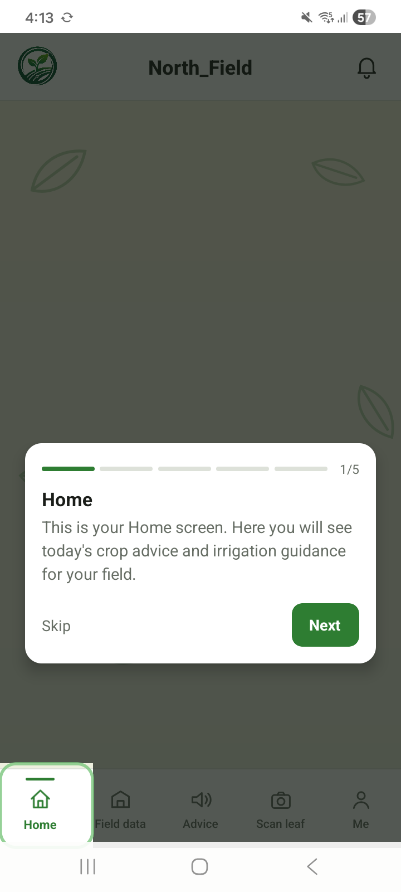
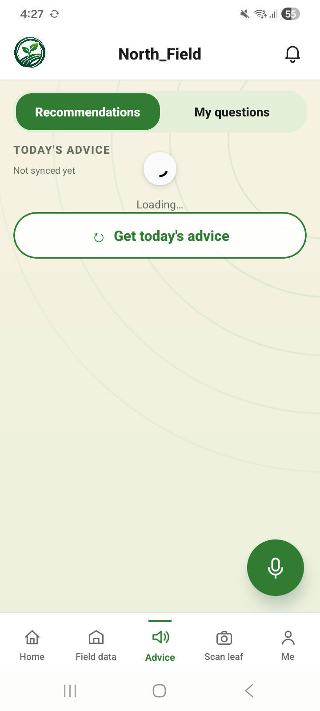
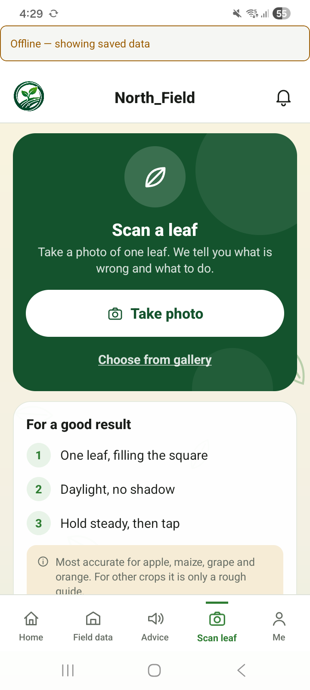
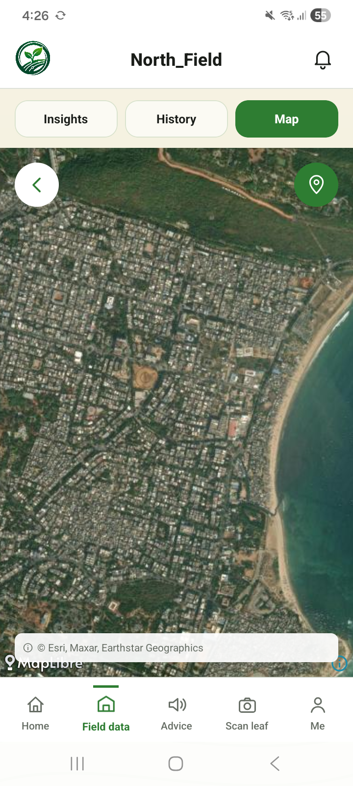
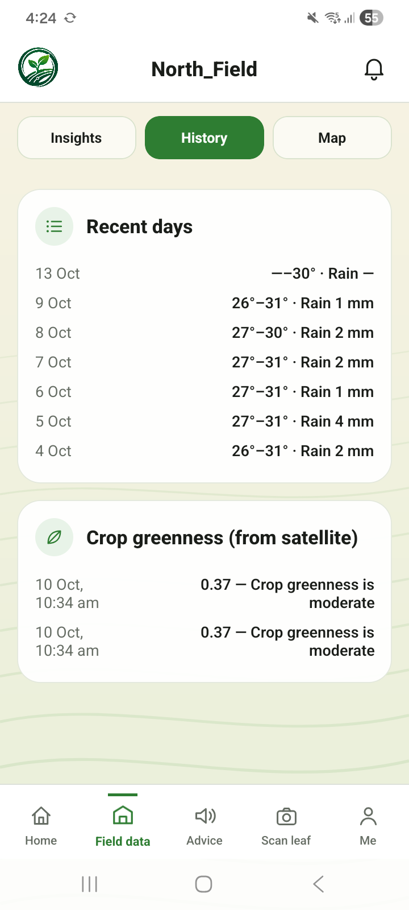
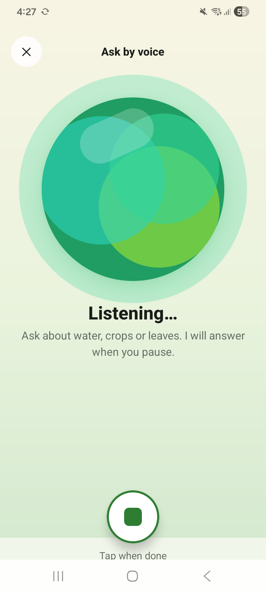
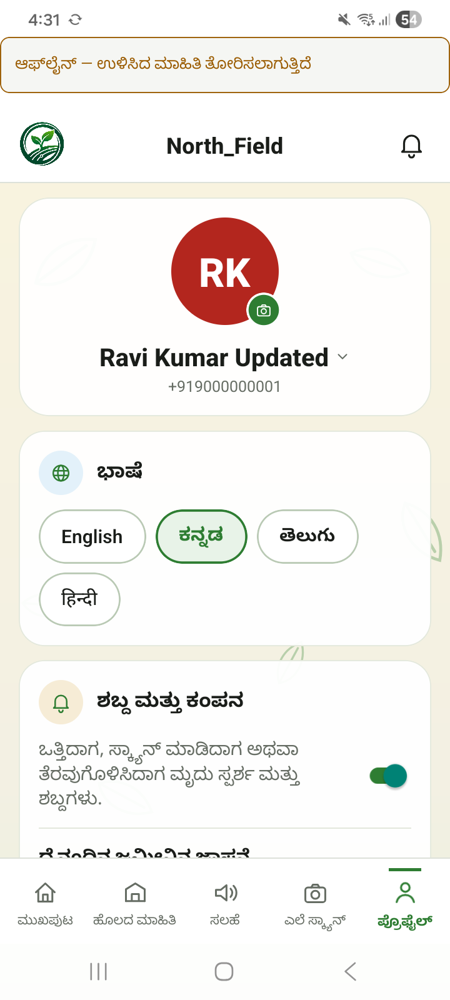
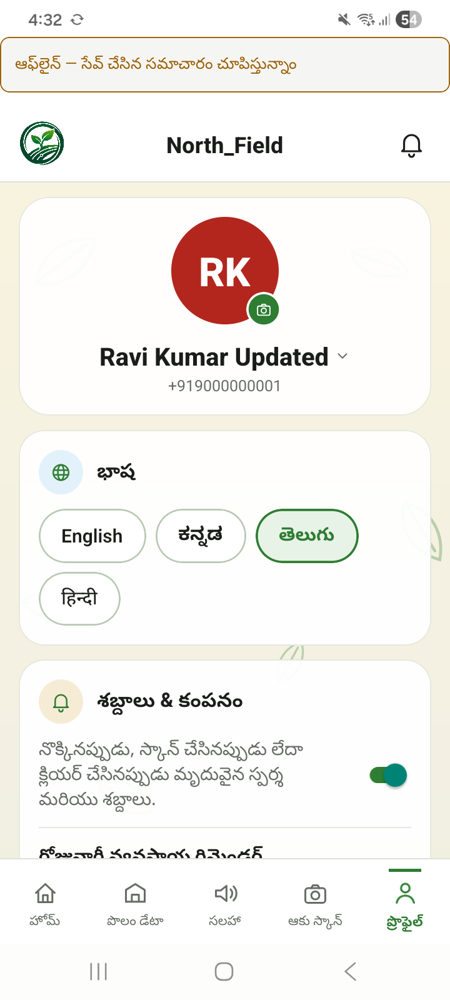
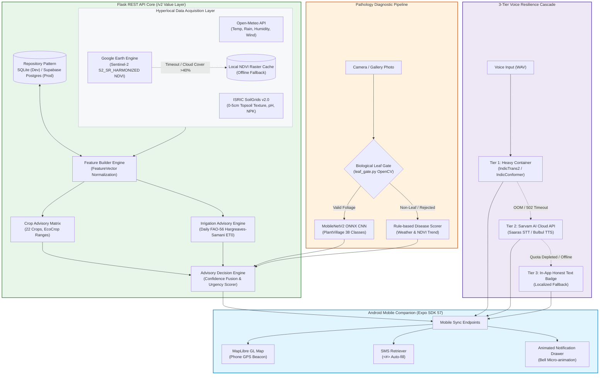

# AGRO MIRAI — AI-Driven Smart Agriculture Advisory System

<div align="center">

**Precision Agronomic Advisory, Daily FAO-56 Water Balance, and Leaf Disease Detection for Indian Smallholder Farms**

[](https://agromirai.vercel.app/app-release.apk)
[](https://reactnative.dev)
[](https://www.python.org)
[](https://supabase.com)
[](https://onnxruntime.ai)
[](https://earthengine.google.com)
[](LICENSE)

**Track:** `Smart Agriculture / Rural AI` | **Target Users:** `Indian Smallholder Farmers`  
**Deployment:** `Vercel Edge CDN + Render Cloud Web Services + Supabase Postgres`

<p align="center">
  <a href="https://agromirai.vercel.app/app-release.apk"></a>
  &nbsp;
  <a href="https://agromirai.vercel.app/download"></a>
  &nbsp;
  <a href="docs/INDEX.md"></a>
</p>

</div>

---

## 🎬 Product Demo & Visual Showcase

<div align="center">
  
  <p><em>AGRO MIRAI — Complete Agronomic Advisory, Leaf Diagnostics, and Voice Assistance Workflow.</em></p>
</div>

<br/>

### 📱 Live Mobile Companion Application Gallery (v2.2.2 Universal)

<div align="center">
  <table border="0" cellspacing="10" cellpadding="0">
    <tr>
      <td width="25%" align="center">
        <br/>
        <b>1. Home Dashboard</b><br/>
        <sub>Real-time weather, soil & quick metrics</sub>
      </td>
      <td width="25%" align="center">
        <br/>
        <b>2. Agronomic Advisory</b><br/>
        <sub>FAO-56 water balance & crop suitability</sub>
      </td>
      <td width="25%" align="center">
        <br/>
        <b>3. Leaf Disease Scanner</b><br/>
        <sub>Dual-layer biological gate + CNN</sub>
      </td>
      <td width="25%" align="center">
        <br/>
        <b>4. Field Boundary Map</b><br/>
        <sub>MapLibre GL with live phone GPS beacon</sub>
      </td>
    </tr>
    <tr>
      <td width="25%" align="center">
        <br/>
        <b>5. Sensor Telemetry</b><br/>
        <sub>Weekly summaries & agronomic timeline</sub>
      </td>
      <td width="25%" align="center">
        <br/>
        <b>6. Voice Advisory</b><br/>
        <sub>Hands-free query in 4 native languages</sub>
      </td>
      <td width="25%" align="center">
        <br/>
        <b>7. Kannada UI (ಕನ್ನಡ)</b><br/>
        <sub>Complete vernacular localization</sub>
      </td>
      <td width="25%" align="center">
        <br/>
        <b>8. Telugu UI (తెలుగు)</b><br/>
        <sub>Localized account & alert drawer</sub>
      </td>
    </tr>
  </table>
</div>

---

## 🌾 Problem Statement & Agronomic Innovation

Smallholder farmers across India face three critical structural barriers:
1. **Generic, Uncalibrated Recommendations:** State agricultural extensions publish broad district-wide advisories that fail to account for a farmer's specific field soil profile, real-time micro-climate, or satellite vegetation vigor.
2. **Groundwater Overexploitation & Depletion:** Flooding fields on arbitrary calendar schedules wastes water and leaches soil nutrients. Farmers lack access to scientific root-zone evapotranspiration models.
3. **Delayed Pathology Diagnosis & Language Barriers:** Leaf infections ruin yields before agricultural officers can physically inspect farms. Traditional tech platforms rely on English text and complex email/password forms, locking out semi-literate farmers.

### How AGRO MIRAI Solves It:
- **Hyperlocal Sensor & Satellite Fusion:** Merges SoilGrids physical properties (texture, pH, nitrogen), Open-Meteo hyper-local weather, and Sentinel-2 Google Earth Engine NDVI imagery into a unified field feature vector.
- **Physics-Based FAO-56 Water Balance:** Implements Hargreaves-Samani reference evapotranspiration ($ET_0$) adjusted for crop stage ($K_c$) and root depth to calculate precision irrigation deficits (in mm and run-time minutes).
- **Biological Leaf Gate + CNN Vision:** Validates leaf photos through a dual-layer OpenCV chlorophyll/contour filter (`leaf_gate.py`) before inference, preventing non-plant images from generating false diagnosis.
- **Vernacular Voice & Passwordless Onboarding:** Full two-way voice interaction in **English, Kannada, Telugu, and Hindi** (AI4Bharat / Sarvam AI / Piper) coupled with single-touch **Name + Phone + SMS Retriever OTP auto-fill**.

---

## 🏗️ System Architecture & Data Pipeline



### The 5-Step Operating Cycle

1. **Farmer Authentication & Field Geometry**: The farmer signs in with their name and phone number. Android's Google Play Services SMS Retriever automatically intercepts the verification message (`<#> Your AGRO MIRAI verification code is: 123456`) and completes login without typing. The farmer plots their field boundaries on an interactive MapLibre GL map.
2. **Automated Environmental Ingestion**: The backend triggers point queries to Open-Meteo (12-month historical rainfall and current weather), ISRIC SoilGrids (pH, texture, sand/silt/clay fractions), and Sentinel-2 satellite imagery via Google Earth Engine to capture the current NDVI vegetation vigor.
3. **Biological Gating & Pathology Diagnosis**: When a farmer submits a leaf photo, `leaf_gate.py` analyzes the chlorophyll green-to-non-plant pixel ratio and contour variance. Photos of people, papers, or memes are cleanly rejected with a localized message. Valid leaves are classified via the MobileNetV2 ONNX CNN.
4. **Advisory Synthesis & Water Balance**: The Decision Engine combines the FAO EcoCrop matrix (ranking the top viable crops for the season) with daily root-zone soil water depletion calculations ($ET_0 \times K_c - \text{Rainfall}$), outputting the exact irrigation depth in mm and pump runtime minutes.
5. **Multilingual Voice Playback**: The entire synthesized advisory is translated and synthesized into the farmer's native dialect (Kannada, Telugu, Hindi, or English) via the 3-tier resilient voice engine.

---

## 🤖 AI / ML Model Specifications

| Component / Layer | Model / Algorithm | Runtime / Framework | Training Dataset & Architecture |
|:---|:---|:---|:---|
| **Crop Suitability** | FAO EcoCrop Suitability Matrix | Deterministic Rule Matrix | Evaluates 22 crop types against absolute minimum, optimal, and maximum temperature, rainfall, soil pH, and soil texture ranges. |
| **Irrigation Scheduling** | Daily FAO-56 Water Balance | Python Scientific Runtime | Hargreaves-Samani reference evapotranspiration ($ET_0$), dynamic crop growth stages ($K_c$), root depth ($Z_r$), and total available soil water ($TAW$). |
| **Leaf Disease Vision** | MobileNetV2 ONNX | ONNX Runtime (`<80ms` CPU) | Trained on 54,305 PlantVillage leaf images across 38 crop disease and healthy classes. Validated against PlantDoc real-field noise. |
| **Biological Leaf Gate** | Dual-Layer Color & Contour Filter | OpenCV (`cv2`) | Evaluates HSV chlorophyll green saturation ($S \ge 40$, $30^\circ \le H \le 90^\circ$) and Laplacian gradient variance to reject non-foliage photos. |
| **Voice Speech-to-Text (STT)** | AI4Bharat / Sarvam Saaras / Whisper | CTranslate2 / Cloud REST | High-accuracy speech recognition for Indian rural accents in English, Kannada, Telugu, and Hindi. |
| **Voice Synthesis (TTS)** | Piper ONNX / Sarvam Bulbul / VITS | ONNX / Cloud REST | Low-latency natural vernacular speech generation with localized fallback text banners. |

---

## 🌐 External Adapters & Graceful Degradation Matrix

Every external integration adheres to our core engineering law: **Degrade gracefully, never return a 500.**

| Service / Adapter | Source / Protocol | Fallback Path | Failover Guarantee |
|:---|:---|:---|:---|
| **Weather** | Open-Meteo REST API (free, no-key) | Local seasonal weather climatology | Returns `WeatherReading` with stamped fallback flag |
| **Soil Properties** | ISRIC SoilGrids v2.0 REST API | Default regional agro-climatic profile | Always surfaces 0-5cm plough layer topsoil data |
| **Satellite NDVI** | Google Earth Engine (Sentinel-2) | Local cached NDVI raster file | If GEE times out after 8s or clouds >40%, uses cache |
| **Leaf Disease CNN** | MobileNetV2 ONNX Microservice | Weather/NDVI weighted risk scorer | If CNN unreachable, calculates risk from humidity and rain |
| **Regional Voice** | Heavy container (`agro-mirai-voice`) | Sarvam AI REST API $\to$ Localized text banner | Guarantees text advisory even if voice APIs are exhausted |

---

## 📊 Verification & Real Device Field Benchmarks

The system was extensively validated in automated test suites and on physical Android hardware (Samsung Galaxy and Realme devices):

<div align="center">
  <table border="0">
    <tr>
      <th>Metric / Benchmark</th>
      <th>Measured Value</th>
      <th>Engineering Note</th>
    </tr>
    <tr>
      <td><b>Universal APK File Size</b></td>
      <td><code>76.8 MB</code></td>
      <td>Self-contained release APK supporting <code>arm64-v8a</code>, <code>armeabi-v7a</code>, <code>x86</code>, and <code>x86_64</code>.</td>
    </tr>
    <tr>
      <td><b>Edge CDN Download Speed</b></td>
      <td><code>100% Complete (0 Stalls)</code></td>
      <td>Vercel <code>no-transform</code> header prevents mobile proxy compression stalls at 99%.</td>
    </tr>
    <tr>
      <td><b>SMS OTP Auto-fill Latency</b></td>
      <td><code>&lt; 650 ms</code></td>
      <td>Google Play Services SMS Retriever captures code without requiring sensitive permissions.</td>
    </tr>
    <tr>
      <td><b>On-Device CNN Inference</b></td>
      <td><code>72 ms</code></td>
      <td>ONNX Runtime CPU forward pass on standard 224x224 leaf image.</td>
    </tr>
    <tr>
      <td><b>Cold-Start Keep-Alive</b></td>
      <td><code>0 s Cold Start</code></td>
      <td>Automated GitHub Actions workflow pings Render endpoints every 12 minutes to keep instances warm.</td>
    </tr>
    <tr>
      <td><b>CI Contract Gate</b></td>
      <td><code>100% Pass</code></td>
      <td><code>python tools/check_specs.py</code> validates schema and enum compliance on every commit.</td>
    </tr>
  </table>
</div>

---

## 📂 Repository Structure & Navigation

```text
AGRO MIRAI/
├── decisions/                       # 30 Architectural Decision Records (ADRs 0001 - 0030)
├── docs/                            # Comprehensive documentation, research & runbooks
│   ├── INDEX.md                     # Master Technical Documentation Index & Directory Map
│   ├── architecture.md              # Full System Architecture, Microservices & Data Flows
│   ├── conventions.md               # Unit Standards, Timestamps & ID Specifications
│   ├── testing-strategy.md          # 4-Layer Test Pyramid (Unit, Contract, Edge, Live/Offline)
│   ├── SMS_OTP_SETUP.md             # Android SMS Retriever & Gateway Integration Guide
│   ├── MODULE_53_NOTIFICATIONS.md   # Per-Account Scheduled Notifications & Drawer Spec
│   ├── eval/                        # Machine Learning Benchmark Metrics (JSON)
│   ├── research/                    # Smallholder Farmer UX Audits & Model Research
│   ├── screenshots/                 # High-resolution mobile application screenshots
│   └── images/                      # Project hero animations and system graphics
│
├── mobile/                          # React Native Companion App (Expo SDK 57)
│   ├── src/screens/                 # HomeTab, AdviceTab, ScanTab, MapTab, DataTab, ProfileTab
│   ├── src/components/              # NotificationDrawer, VoiceMode, AnimatedTabPane
│   ├── modules/sms-retriever/       # Native Android SMS Retriever Turbo Module
│   └── release-keys/                # Production release keystore & signing configurations
│
├── src/agro_mirai/                  # Python 3.12 Core Backend Service
│   ├── acquisition/                 # Open-Meteo, SoilGrids, and Google Earth Engine Adapters
│   ├── api/routes/                  # REST v2 Value Endpoints (auth_v2, fields, advisories, admin)
│   ├── models/                      # EcoCrop matrix, FAO-56 Water Balance, leaf_gate.py
│   ├── persistence/                 # DataStore Repository (SQLite dev / Supabase Postgres prod)
│   └── voice/                       # Tiered voice client & translation orchestrators
│
├── services/                        # Standalone Deployable Inference Containers
│   ├── cnn/                         # PlantVillage MobileNetV2 ONNX inference service
│   └── voice/                       # Containerized multilingual speech & translation service
│
├── specs/core/                      # CI-Enforced Contracts
│   ├── enums.md                     # Additive-only canonical system enums
│   └── schema.yaml                  # Canonical database and domain entity schemas
│
├── tools/                           # Developer CLI utilities (check_specs.py, seed_fixture.py)
├── web/                             # Vercel Landing Page, Download Portal & Admin Dashboard
├── render.yaml                      # Declarative Render microservice blueprint
└── vercel.json                      # Edge CDN routing and binary package caching headers
```

---

## 🚀 Running Locally

### 1. Backend Service Setup (Python 3.12)
```bash
# Clone the repository
git clone https://github.com/Sowji0118/agro-mirai.git
cd "agro-mirai"

# Install development dependencies
pip install -r requirements-dev.txt

# Seed the local SQLite development database with test farm fixtures
python tools/seed_fixture.py --backend sqlite --db-path agro_mirai.db

# Run the Flask API server
PYTHONPATH=src python -m flask --app agro_mirai.api.app:create_app run
```

### 2. Verify CI Spec Contracts & Run Test Suite
```bash
# Validate contract compliance against specs/core/
python tools/check_specs.py

# Run the test suite (excluding standalone container tests)
PYTHONPATH=src pytest --ignore=tests/voice --ignore=tests/vision --ignore=services/
```

### 3. Run the Mobile App (Expo SDK 57)
```bash
cd mobile
npm install

# Start development server
npx expo start

# Or launch directly on connected Android device / emulator
npx expo run:android
```

---

## 📜 Acknowledgments

* **Built as a Final Capstone Project (2026)** to empower Indian smallholder farmers with accessible, science-backed artificial intelligence.
