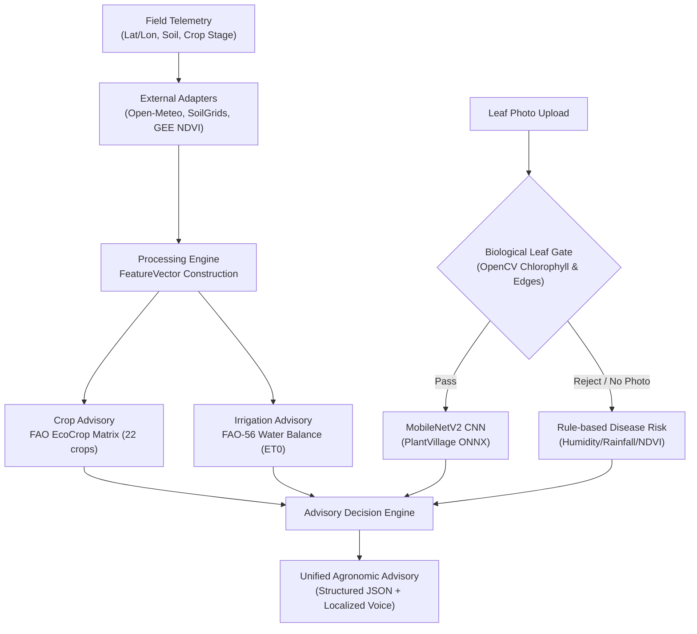

# AGRO MIRAI — Master Documentation & Architectural Index

Welcome to the central technical documentation index for **AGRO MIRAI**, the AI-driven smart agriculture advisory platform for Indian smallholder farmers.

---

## 📑 Master Navigation & Directory Taxonomy

```
docs/
├── INDEX.md                             # Master Documentation Hub (This File)
├── NEXT_TEAM_HANDOVER.md                # Authoritative Technical Handover & Production Runbook
├── architecture.md                      # Core System Architecture, Component Map & Pipelines
├── conventions.md                       # Data formats, unit standards, and naming conventions
├── testing-strategy.md                  # 4-layer testing hierarchy & CI gating strategy
├── TOOLING.md                           # Environment setup, dependencies, and CLI tools
├── ROADMAP_PRODUCTION.md                # Production engineering roadmap & gap analysis
│
├── [Authentication & Identity]
│   ├── ACCOUNTS.md                      # Farmer phone+OTP tenancy, credentials & session auth
│   ├── SMS_OTP_SETUP.md                 # SMS Gateway, 2Factor/MSG91 & Play Services SMS Retriever
│   └── MOBILE_FEEDBACK_AND_OTP.md       # In-app OTP dialogs & farmer feedback collection
│
├── [Mobile & Client Architecture]
│   ├── MODULE_53_NOTIFICATIONS.md       # Per-account notifications, daily reminder engine & drawer
│   ├── MODULE_53_SESSION_HANDOFF.md     # Notification session implementation notes
│   ├── MOBILE_ONBOARDING_NOTIFICATIONS.md# First-time onboarding flows & permission gating
│   └── superpowers/plans/               # UI redesign plans (Home tab, Admin dashboard)
│
├── [Deployment & Infrastructure]
│   ├── deploy/oracle-vm-setup.md        # Oracle Cloud Always Free Ampere A1 voice setup
│   ├── BACKUPS.md                       # Supabase Postgres and SQLite backup procedures
│   └── SESSION_HANDOFF_SPLASH_AND_RELEASE.md # Release signing, splash screen & asset packaging
│
├── [AI/ML Models & Evaluations]
│   ├── eval/crop_rf_eval.json           # 22-Crop recommendation benchmark metrics
│   ├── eval/disease_cnn_eval.json       # MobileNetV2 leaf disease benchmark metrics
│   ├── eval/disease_cnn_plantdoc_eval.json # PlantDoc evaluation against real-world field photos
│   └── eval/irrigation_rf_eval.json     # ET0 irrigation prediction model metrics
│
├── [Farmer Field Research & Audits]
│   ├── research/module-43-codebase-audit.md  # Comprehensive architectural and vulnerability audit
│   ├── research/module-43-farmer-ux-research.md# Smallholder farmer UX and field usability study
│   └── research/module-43-model-research.md  # EcoCrop, FAO-56 and CNN model research findings
│
├── [Demos, Presentations & Audits]
│   ├── DEMO_DAY.md                      # Live demonstration guide, cold-start mitigation
│   ├── DEMO_SCRIPT.md                   # Step-by-step presentation script & voice demo notes
│   ├── PROJECT_WALKTHROUGH.md           # End-to-end user journey walkthrough
│   └── PPT_VS_CODE_AUDIT.md             # Rigorous comparison between project slides & code
│
└── [Historical Session Logs]
    ├── SESSION_LOG_2026-09.md           # September 2026 foundation & microservices split logs
    ├── SESSION_LOG_2026-10-module-52.md # October 2026 multi-account & admin panel logs
    ├── MODULE_20_HANDOFF.md             # Module 20 (Disease CNN) handoff
    └── MODULE_41_HANDOFF.md             # Module 41 (Render 3-service split) handoff
```

---

## 1. Core Architecture & System Specifications

| Document | Primary Focus | Load-Bearing Modules |
|:---|:---|:---|
| **[`docs/architecture.md`](file:///c:/Projects/AGRO%20MIRAI/docs/architecture.md)** | End-to-end component flow, adapters, repository pattern, biological leaf gate, and 3-tier voice fallback. | `acquisition/`, `models/`, `api/`, `persistence/` |
| **[`docs/NEXT_TEAM_HANDOVER.md`](file:///c:/Projects/AGRO%20MIRAI/docs/NEXT_TEAM_HANDOVER.md)** | Complete production handover: v2.2.2 Universal APK build, Vercel Edge CDN pipeline, SMS auto-fill, and admin log lookup. | `mobile/`, `services/`, `web/admin/` |
| **[`docs/conventions.md`](file:///c:/Projects/AGRO%20MIRAI/docs/conventions.md)** | Standard units (°C, mm, %, deg), ISO 8601 UTC timestamps, and strict entity ID formats. | All modules |
| **[`docs/testing-strategy.md`](file:///c:/Projects/AGRO%20MIRAI/docs/testing-strategy.md)** | 4-layer testing philosophy: Unit, Contract, Edge case, and Live/Offline service isolation. | `tests/` |
| **[`specs/core/enums.md`](file:///c:/Projects/AGRO%20MIRAI/specs/core/enums.md)** | Additive-only enum definitions gated by `tools/check_specs.py` on every CI run. | Contract gating |
| **[`specs/core/schema.yaml`](file:///c:/Projects/AGRO%20MIRAI/specs/core/schema.yaml)** | Canonical entity schemas for `Farmer`, `Field`, `SoilSample`, `WeatherReading`, `Advisory`. | Contract gating |

---

## 2. Architecture Decision Records (ADRs)

Located in **[`decisions/`](file:///c:/Projects/AGRO%20MIRAI/decisions/)**, these 30 formal records document all architectural choices and trade-offs:

### Foundation & Tenancy (0001–0006)
- **[`0001-index.md`](file:///c:/Projects/AGRO%20MIRAI/decisions/0001-index.md)**: ADR directory structure, status lifecycles, and numbering rules.
- **[`0002-id-format.md`](file:///c:/Projects/AGRO%20MIRAI/decisions/0002-id-format.md)**: Deterministic prefixed UUIDs (`farm-`, `fld-`, `adv-`).
- **[`0003-single-farmer-tenancy.md`](file:///c:/Projects/AGRO%20MIRAI/decisions/0003-single-farmer-tenancy.md)**: Initial single-farmer scoping and subsequent multi-tenant migration boundary.
- **[`0004-gee-timeout-and-fallback.md`](file:///c:/Projects/AGRO%20MIRAI/decisions/0004-gee-timeout-and-fallback.md)**: 8-second GEE timeout, 40% cloud ceiling, and local raster cache fallback.
- **[`0005-migration-generation.md`](file:///c:/Projects/AGRO%20MIRAI/decisions/0005-migration-generation.md)**: Declarative SQLite and Supabase PostgreSQL schema migrations.
- **[`0006-missing-data-policy.md`](file:///c:/Projects/AGRO%20MIRAI/decisions/0006-missing-data-policy.md)**: Strict `422 Unprocessable Entity` policy over silent defaulting.

### Agronomic Models & Explainability (0007–0012)
- **[`0007-crop-model-feature-mapping.md`](file:///c:/Projects/AGRO%20MIRAI/decisions/0007-crop-model-feature-mapping.md)**: FeatureVector to 7-feature Kaggle crop model mapping.
- **[`0008-irrigation-model-feature-mapping.md`](file:///c:/Projects/AGRO%20MIRAI/decisions/0008-irrigation-model-feature-mapping.md)**: 3-class urgency classification vs continuous depth prediction.
- **[`0009-disease-risk-model.md`](file:///c:/Projects/AGRO%20MIRAI/decisions/0009-disease-risk-model.md)**: Weighted multi-factor weather/NDVI risk rule-based model.
- **[`0010-explainability.md`](file:///c:/Projects/AGRO%20MIRAI/decisions/0010-explainability.md)**: TreeSHAP local feature attribution and human-readable natural language synthesis.
- **[`0011-decision-engine.md`](file:///c:/Projects/AGRO%20MIRAI/decisions/0011-decision-engine.md)**: Synchronous orchestration pipeline producing unified advisories.
- **[`0012-feedback-loop.md`](file:///c:/Projects/AGRO%20MIRAI/decisions/0012-feedback-loop.md)**: Farmer feedback capture (`was_helpful`, `action_taken`, freeform text).

### Production Hardening & Multi-tenancy (0013–0020)
- **[`0013-frontend-platform-sequencing.md`](file:///c:/Projects/AGRO%20MIRAI/decisions/0013-frontend-platform-sequencing.md)**: React Native / Expo mobile app prioritization over web dashboard.
- **[`0014-deploy-target-and-voice-scope.md`](file:///c:/Projects/AGRO%20MIRAI/decisions/0014-deploy-target-and-voice-scope.md)**: Render web service + external voice compute scoping.
- **[`0015-et0-water-balance.md`](file:///c:/Projects/AGRO%20MIRAI/decisions/0015-et0-water-balance.md)**: Daily FAO-56 root-zone water balance model replacing purely empirical RF regression.
- **[`0016-regional-crop-suitability.md`](file:///c:/Projects/AGRO%20MIRAI/decisions/0016-regional-crop-suitability.md)**: State-level ICAR/agronomic suitability filters preventing unviable crop recommendations.
- **[`0017-multi-tenant-v2.md`](file:///c:/Projects/AGRO%20MIRAI/decisions/0017-multi-tenant-v2.md)**: Schema evolution to multi-farmer tenant isolation.
- **[`0018-disease-cnn.md`](file:///c:/Projects/AGRO%20MIRAI/decisions/0018-disease-cnn.md)**: PlantVillage MobileNetV2 image classification container.
- **[`0019-deployment-architecture.md`](file:///c:/Projects/AGRO%20MIRAI/decisions/0019-deployment-architecture.md)**: Production deployment topology across Render, Supabase, and Vercel.
- **[`0020-v2-value-endpoints-and-voice-api.md`](file:///c:/Projects/AGRO%20MIRAI/decisions/0020-v2-value-endpoints-and-voice-api.md)**: REST v2 value endpoint architecture with audio payload support.

### Regional Languages & Microservices (0021–0030)
- **[`0021-language-expansion-te-hi.md`](file:///c:/Projects/AGRO%20MIRAI/decisions/0021-language-expansion-te-hi.md)**: Expansion from English/Kannada to Telugu and Hindi.
- **[`0022-supabase-auth-migration.md`](file:///c:/Projects/AGRO%20MIRAI/decisions/0022-supabase-auth-migration.md)**: Supabase PostgreSQL authentication engine integration.
- **[`0023-name-phone-otp-auth.md`](file:///c:/Projects/AGRO%20MIRAI/decisions/0023-name-phone-otp-auth.md)**: Passwordless Name + Phone + 6-digit OTP login designed for rural smallholders.
- **[`0024-user-entered-content-i18n.md`](file:///c:/Projects/AGRO%20MIRAI/decisions/0024-user-entered-content-i18n.md)**: Multilingual translation strategy for farmer-entered notes.
- **[`0025-onnx-cnn-service.md`](file:///c:/Projects/AGRO%20MIRAI/decisions/0025-onnx-cnn-service.md)**: Stripping heavy PyTorch dependencies in favor of lightweight ONNX Runtime.
- **[`0026-three-microservices-render-split.md`](file:///c:/Projects/AGRO%20MIRAI/decisions/0026-three-microservices-render-split.md)**: 3-microservice architecture staying within Render's 512 MB free RAM tier.
- **[`0027-ecocrop-and-waterbalance-urgency.md`](file:///c:/Projects/AGRO%20MIRAI/decisions/0027-ecocrop-and-waterbalance-urgency.md)**: Deterministic FAO EcoCrop suitability matrices.
- **[`0028-disease-cnn-plantdoc-and-named-risks.md`](file:///c:/Projects/AGRO%20MIRAI/decisions/0028-disease-cnn-plantdoc-and-named-risks.md)**: PlantDoc evaluation handling field noise, background foliage, and varied illumination.
- **[`0029-remove-tabular-service-and-rf-models.md`](file:///c:/Projects/AGRO%20MIRAI/decisions/0029-remove-tabular-service-and-rf-models.md)**: Removal of redundant tabular ML microservice in favor of robust agronomic rules.
- **[`0030-admin-write-actions.md`](file:///c:/Projects/AGRO%20MIRAI/decisions/0030-admin-write-actions.md)**: Role-based admin actions (field reassignment, status overrides, audit logs).

---

## 3. Agronomic Engine & AI Model Specifications



| Advisory Domain | Model / Method | Benchmark / Specification | Reference Document |
|:---|:---|:---|:---|
| **Crop Ranking** | FAO EcoCrop Suitability Rules | 22 crop types evaluated against temperature, rainfall, pH, and soil texture | [`decisions/0027`](file:///c:/Projects/AGRO%20MIRAI/decisions/0027-ecocrop-and-waterbalance-urgency.md) |
| **Irrigation Depth** | FAO-56 Daily Water Balance | Hargreaves-Samani ET0 reference evapotranspiration, crop coefficient $K_c$, root depth, soil water depletion | [`decisions/0015`](file:///c:/Projects/AGRO%20MIRAI/decisions/0015-et0-water-balance.md) |
| **Disease Inference** | MobileNetV2 ONNX CNN | PlantVillage trained; 38 disease/healthy classes running in `<80ms` | [`decisions/0025`](file:///c:/Projects/AGRO%20MIRAI/decisions/0025-onnx-cnn-service.md) |
| **Biological Leaf Gate** | Dual-Layer OpenCV Filter | Chlorophyll green saturation ratio + Laplacian contour variance | [`src/agro_mirai/models/leaf_gate.py`](file:///c:/Projects/AGRO%20MIRAI/src/agro_mirai/models/leaf_gate.py) |
| **Disease Weather Risk** | Weighted Multi-Factor Scorer | 4-variable weighted rule set (humidity >85%, rainfall >10mm, temp 20–30°C, NDVI drop) | [`decisions/0009`](file:///c:/Projects/AGRO%20MIRAI/decisions/0009-disease-risk-model.md) |
| **Voice Cascade** | 3-Tier Multilingual Cascade | IndicTrans2 / VITS → Sarvam AI (`saaras`/`bulbul`) → Localized text fallback | [`docs/NEXT_TEAM_HANDOVER.md`](file:///c:/Projects/AGRO%20MIRAI/docs/NEXT_TEAM_HANDOVER.md) |

---

## 4. Mobile Companion App & Distribution (v2.2.2)

- **Distribution Channel**: Direct Vercel Edge CDN download at [`https://agromirai.vercel.app/app-release.apk`](https://agromirai.vercel.app/app-release.apk).
- **Public Portal**: Download instructions, package size, and checksum at [`https://agromirai.vercel.app/download`](https://agromirai.vercel.app/download).
- **Network Resilience**: `no-transform` header in `vercel.json` blocks intermediate ISP proxy compression, preventing 99% download stalls.
- **Native Verification**: Google Play Services SMS Retriever integration auto-fills codes formatted as `<#> Your AGRO MIRAI verification code is: 123456`.
- **Field Navigation**: MapLibre GL map layer with dynamic device GPS auto-centering and blue pulse beacon.
- **Design System**: Fully migrated to `lucide-react-native` vector icons, spring-scaled navigation bar, and animated notification drawer.
